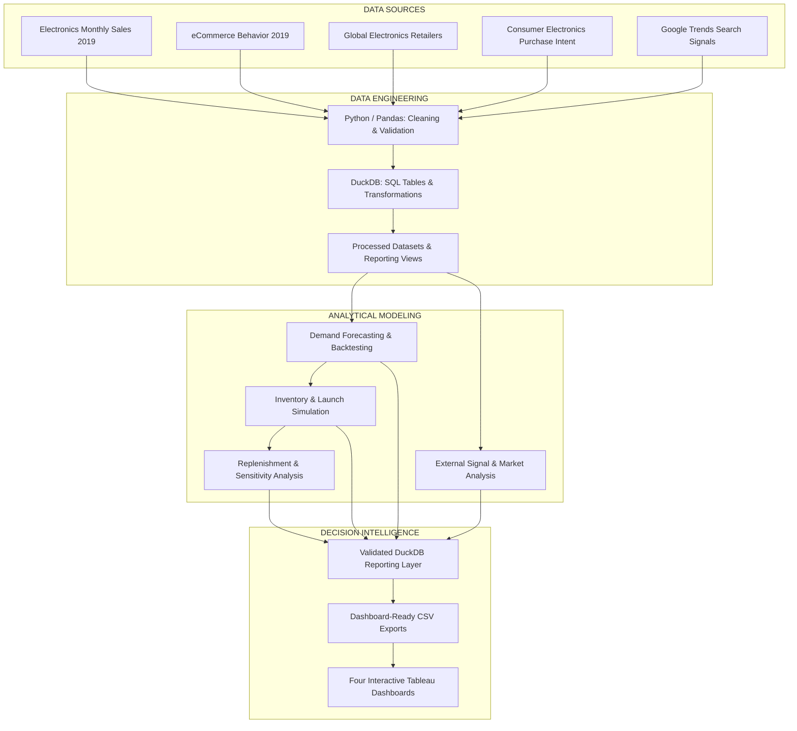
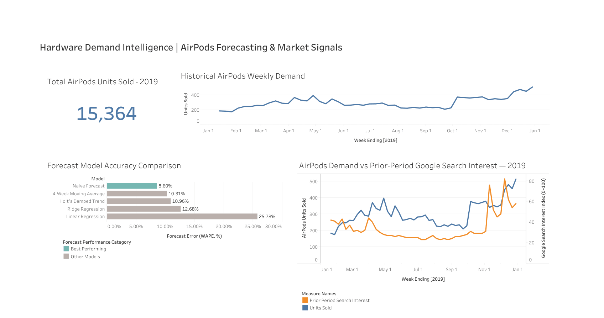
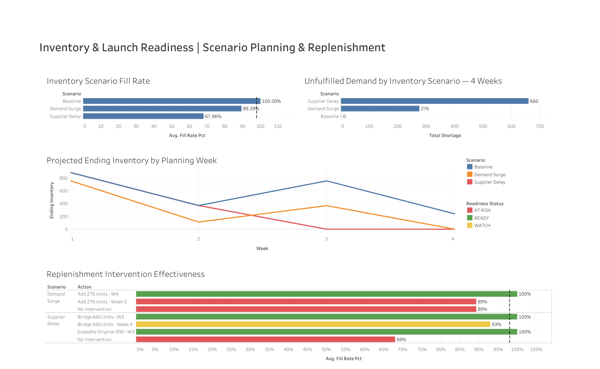
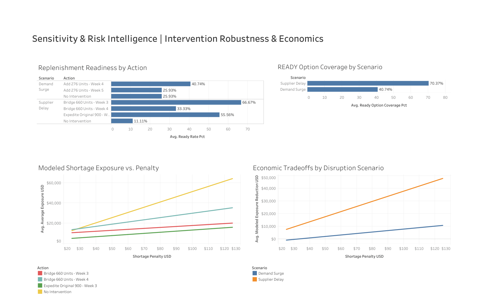
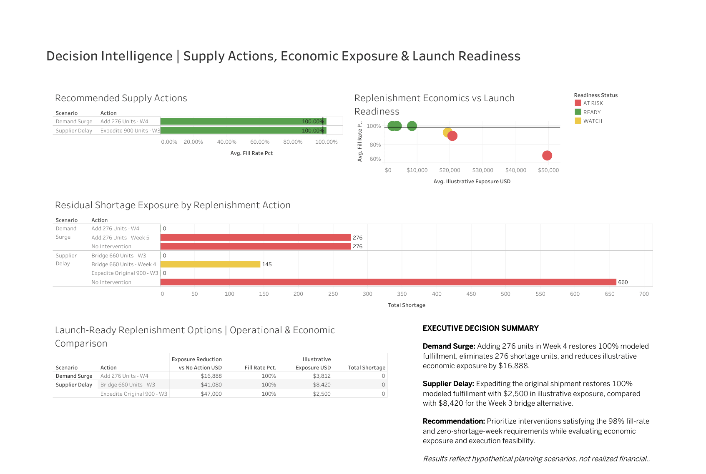

# Hardware Demand-Sensing & Launch Readiness Planner

**An End-to-End Supply Chain Analytics & Decision Intelligence Project**

*Python | SQL | DuckDB | Machine Learning | Demand Forecasting | Inventory Optimization | Tableau*

## 1. Project Overview

Hardware supply chains operate under significant uncertainty. Fluctuating consumer demand, evolving market signals, supplier disruptions, and constrained inventory can create shortages, excess stock, and product launch delays. Effective supply chain planning requires more than accurate demand forecasts—it requires translating demand insights into operational decisions.

The **Hardware Demand-Sensing & Launch Readiness Planner** is an end-to-end analytics and decision-support system designed to evaluate demand patterns, forecast accuracy, inventory readiness, and replenishment strategies under changing operating conditions.

The project integrates multiple electronics-related datasets and external search-interest indicators into a Python and DuckDB analytics workflow, using separate analyses where source populations are not directly comparable. It evaluates forecasting approaches, simulates inventory disruptions, and assesses alternative replenishment actions through scenario modeling and sensitivity analysis.

Interactive Tableau dashboards translate the analytical outputs into actionable business intelligence, helping decision-makers understand tradeoffs between fulfillment performance, inventory availability, shortage exposure, and launch readiness.

**Core objective:** Demonstrate how data-driven forecasting, supply chain modeling, and operational decision intelligence can support more resilient hardware planning and launch execution.

## 2. Executive Summary & Key Results

The Hardware Demand-Sensing & Launch Readiness Planner combines historical demand forecasting, external market signals, inventory simulation, and replenishment decision analysis into an integrated supply chain analytics workflow.

The project evaluates how demand volatility and supplier disruptions affect fulfillment performance, then identifies replenishment strategies that can improve modeled launch readiness while reducing potential shortage-related economic exposure.

### Key Quantitative Results

| Performance Indicator | Validated Result |
|---|---|
| Historical Demand Analyzed | 15,364 AirPods units across 51 reporting weeks |
| Best Forecasting Model | Naive Forecast — **8.60% WAPE** across 19 rolling-origin evaluations |
| Inventory Disruption Scenarios | Baseline, Demand Surge, and Supplier Delay |
| Sensitivity Analysis | **567 intervention evaluations** across 162 simulated operating cases |
| Maximum Modeled Exposure Reduction | **$47,000** under the Supplier Delay scenario |
| Data Warehouse Validation | **18 of 18 DuckDB reporting views** successfully reconciled |

### Key Business Findings

**1. Simple forecasting methods can outperform more complex models.**

Five forecasting approaches were compared using historical AirPods demand. The naive forecast achieved the lowest error, outperforming moving averages, Holt's damped trend, Ridge regression, and linear regression in the original rolling-origin evaluation.

**2. Supply disruptions can materially affect launch readiness.**

In the four-week inventory simulation, a demand-surge scenario produced 276 units of unmet demand, while a supplier-delay scenario produced 660 units. These scenarios reduced modeled fill rates to 89.29% and 67.96%, respectively, compared with 100% under baseline conditions.

**3. Targeted replenishment actions can mitigate modeled shortage exposure.**

Adding 276 units in Week 4 eliminated the modeled demand-surge shortage. Under the supplier-delay scenario, expediting the original shipment restored the modeled fill rate to 100% and reduced illustrative economic exposure by $47,000 relative to no intervention.

**4. Launch readiness must be evaluated under uncertainty.**

Sensitivity testing showed that at least one READY replenishment option was available in 40.74% of Demand Surge operating cases and 70.37% of Supplier Delay operating cases. This illustrates why a strategy that succeeds under baseline assumptions may not remain feasible under changing conditions.

### Decision-Making Value

The resulting analytics system provides a structured way to compare forecast performance, quantify inventory disruption risks, evaluate replenishment timing, and prioritize interventions based on service levels, shortage exposure, and scenario robustness.

*Results are based on historical datasets and hypothetical supply chain planning assumptions. Economic exposure reductions are simulated decision-model outputs, not realized financial savings. Reporting reproducibility was validated using prepared inputs and an isolated warehouse rebuild.*

## 3. System Architecture & Technical Workflow

The project follows a modular analytical architecture connecting data ingestion, preparation, forecasting, supply planning, sensitivity testing, and executive reporting.

Python handles data preparation and analytical modeling, while DuckDB provides SQL-based storage, transformations, and reporting views. The resulting datasets feed four interactive Tableau dashboards designed for operational decision-making.

### 3.1 System Architecture

*Architecture note: The datasets represent different product populations and observation structures. They are analyzed independently unless a specific temporal alignment or transformation is explicitly defined. The diagram represents the overall analytical workflow, not a single joined transactional dataset.*

### 3.2 Core Technical Components

| Layer | Technology | Purpose |
|---|---|---|
| Data ingestion | Python, Pandas | Import, inspect, clean, and standardize source datasets |
| Data processing | Python, SQL | Aggregate demand, validate records, and construct analytical features |
| Analytical warehouse | DuckDB | Store structured datasets and execute SQL transformations |
| Forecasting | Python, scikit-learn, statsmodels | Evaluate forecasting models through historical backtesting |
| Inventory modeling | Python, Pandas | Simulate fulfillment, inventory depletion, and replenishment timing |
| Sensitivity analysis | Python, SQL | Evaluate intervention robustness across changing operating assumptions |
| Business intelligence | Tableau | Communicate operational KPIs, financial tradeoffs, and supply decisions |
| Version control | Git, GitHub | Track notebooks, analytical outputs, and project documentation |

### 3.3 Analytical Workflow

**Stage 1 — Data Preparation**

Four electronics-related datasets and Google Trends signals are processed into structured analytical inputs. Data cleaning includes schema inspection, data-type validation, missing-value assessment, duplicate checks, and temporal aggregation where applicable.

**Stage 2 — Demand Intelligence**

Historical AirPods demand is aggregated into weekly observations and evaluated using five forecasting models. Separate analyses examine eCommerce behavioral signals, electronics retail patterns, customer purchase intent, and external search-interest indicators.

Forecasting models are evaluated using historical holdout or rolling-origin backtesting, depending on the experiment.

**Stage 3 — Inventory & Launch Readiness**

Historical demand insights inform hypothetical supply-planning scenarios. The inventory simulation evaluates fulfillment performance, shortage quantities, inventory depletion, and inbound replenishment timing across a four-week planning horizon.

**Stage 4 — Sensitivity & Economic Analysis**

Replenishment interventions are evaluated under alternative operating assumptions, including demand, inventory availability, supply timing, and shortage penalties.

The analysis produces 567 intervention evaluations across 162 operating cases, measuring launch readiness, decision coverage, and illustrative economic exposure.

**Stage 5 — Executive Reporting**

Validated analytical outputs are exposed through DuckDB reporting views and exported as dashboard-ready datasets.

Four Tableau dashboards present the results:

1. **Demand Intelligence:** Historical demand, forecasting accuracy, and market signals.
2. **Inventory & Launch Readiness:** Fill rates, shortage exposure, inventory depletion, and replenishment effectiveness.
3. **Sensitivity & Risk Intelligence:** Intervention robustness, decision coverage, and economic sensitivity.
4. **Decision Intelligence:** Candidate supply actions, modeled economics, residual risk, and executive recommendations.

### 3.4 Data Integrity & Reporting Reproducibility

The project includes a dedicated technical validation notebook that independently reconciles forecasting errors, inventory calculations, replenishment economics, sensitivity results, and reporting outputs.

An isolated DuckDB rebuild reproduced all **18 final reporting views**, with matching reporting contents and no modifications to the original warehouse files.

The validated rebuild uses prepared analytical inputs and a copied source database; it does not establish complete reproducibility directly from raw Kaggle downloads.

This architecture separates analytical calculations from executive reporting and supports traceable, evidence-based supply chain decisions.

## 4. Data Sources & Data Preparation

### 4.1 Data Sources

The project incorporates multiple publicly available electronics-related datasets alongside external Google Trends indicators. These sources support distinct analyses of demand forecasting, customer behavior, retail activity, and market conditions.

| Data Source | Analytical Purpose |
|---|---|
| Electronics – Monthly Sales 2019 | Historical AirPods demand analysis, weekly demand aggregation, and forecasting model evaluation |
| eCommerce Behavior Data from Multi-Category Store | Exploration of customer interactions, product activity, and purchasing behavior |
| Global Electronics Retailers | Analysis of broader electronics retail patterns and commercial performance |
| Consumer Electronics Purchase Intent | Supplemental analysis of consumer interest and purchasing indicators |
| Google Trends | External search-interest signals used to investigate potential forecasting improvements |

The historical datasets primarily represent the 2019–2020 period, although coverage varies by source. Google Trends data is analyzed at a weekly frequency for the selected historical comparison period.

**Important:** These datasets do not necessarily represent the same customers, products, retailers, or markets. Their outputs are analyzed separately unless a clearly defined transformation or temporal alignment supports comparison.

### 4.2 Data Cleaning & Transformation

Data preparation was conducted primarily using Python, Pandas, and DuckDB.

The workflow included:

- **Schema inspection:** Examining column definitions, data types, and source structures.
- **Data quality checks:** Reviewing missing values, duplicate records, and inconsistent fields.
- **Temporal aggregation:** Transforming applicable transaction-level observations into weekly analytical datasets.
- **Feature engineering:** Constructing demand, forecasting, inventory, and external-signal variables.
- **SQL transformations:** Creating structured analytical tables and reporting views in DuckDB.
- **Reconciliation:** Comparing processed datasets, warehouse outputs, and Tableau exports to verify reporting consistency.

Intermediate datasets were retained as processed CSV files, supporting analytical traceability and repeatable downstream reporting.

### 4.3 Historical Demand Dataset

The primary forecasting experiment uses historical AirPods demand aggregated into **51 weekly observations totaling 15,364 units**.

This dataset serves as the basis for comparing five forecasting approaches through 19 rolling-origin evaluation periods.

Forecast performance is measured using:

- **Mean Absolute Error (MAE):** Average absolute difference between actual and forecast demand.
- **Weighted Absolute Percentage Error (WAPE):** Total absolute forecast error relative to total actual demand.
- **Forecast Bias:** Direction and magnitude of systematic over- or underforecasting.

The weekly historical series is treated as an analytical benchmark rather than a representation of current AirPods market demand.

### 4.4 External Demand Signals

Google Trends data provides a supplementary perspective on historical consumer search interest.

Six search-interest signals were processed and incorporated into the external-signal analysis. Weekly signal observations were aligned with the historical demand evaluation where applicable, with particular attention to data availability at each forecast origin.

The external-signal experiment examines whether search-interest information improves predictive performance relative to a comparable sales-history-only model.

Results showed improvement within the Ridge regression comparison, but the signal-enhanced Ridge model did not outperform the original naive forecast benchmark.

Google Trends measures normalized relative search interest rather than product sales or actual customer orders. Consequently, search activity is treated as a potential forecasting indicator—not a direct measure of demand or proof of causation.

### 4.5 Data Limitations

Several limitations should be considered when interpreting the results:

1. **Historical coverage:** The datasets largely reflect past electronics market conditions and may not represent current consumer behavior or supply chain dynamics.
2. **Dataset heterogeneity:** Sources differ in product scope, observation granularity, geographic coverage, and commercial context.
3. **External-signal uncertainty:** Search-interest trends may correlate with demand without providing consistent incremental predictive value.
4. **Limited forecasting sample:** The primary forecasting evaluation uses a relatively short historical weekly series.
5. **Simulated supply planning:** Inventory quantities, replenishment interventions, and economic penalty assumptions are modeled rather than observed operating results.

These limitations are explicitly acknowledged to distinguish validated analytical findings from hypothetical operational scenarios.

## 5. Demand Forecasting & Model Evaluation

### 5.1 Forecasting Objective

The forecasting component evaluates how effectively historical demand patterns can be used to anticipate future product demand and support inventory planning decisions.

Using 51 weeks of historical AirPods demand totaling 15,364 units, five forecasting approaches were evaluated through a rolling-origin backtesting framework.

The objective was to establish a reliable forecasting benchmark, compare model complexity against predictive accuracy, and investigate whether external demand signals provide incremental forecasting value.

### 5.2 Forecasting Models

Five models were evaluated:

1. **Naive Forecast:** Uses the most recent observed demand as the next forecast, establishing a simple benchmark.
2. **4-Week Moving Average:** Smooths recent demand fluctuations using the preceding four observations.
3. **Holt's Damped Trend:** Models demand levels and trends while moderating long-term trend extrapolation.
4. **Ridge Regression:** Applies regularized linear regression to historical demand-derived features.
5. **Linear Regression:** Estimates demand using a linear relationship between predictors and the target variable.

### 5.3 Rolling-Origin Backtesting

Models were evaluated across 19 historical forecast origins, allowing predictions to be compared with subsequently observed demand.

Unlike a single train-test split, rolling-origin evaluation tests forecasting performance over multiple historical decision points.

Model performance was assessed using three metrics:

- **MAE:** Average absolute forecast error, measured in demand units.
- **WAPE:** Total absolute forecast error divided by total actual demand, expressed as a percentage.
- **Forecast Bias:** Average signed forecast error, indicating whether predictions systematically overestimate or underestimate demand.

### 5.4 Forecast Accuracy Results

| Forecasting Model | MAE (Units) | WAPE | Forecast Bias (Units) |
|---|---:|---:|---:|
| **Naive Forecast** | **22.16** | **8.60%** | -3.42 |
| 4-Week Moving Average | 26.57 | 10.31% | +4.46 |
| Holt's Damped Trend | 28.24 | 10.96% | +1.10 |
| Ridge Regression | 32.68 | 12.68% | +18.20 |
| Linear Regression | 66.41 | 25.78% | +54.06 |

*Results were independently recalculated and reconciled against the original rolling-origin prediction outputs.*

**Key finding:** The naive forecast achieved the lowest WAPE and MAE among the five evaluated models.

This result illustrates that more complex forecasting methods do not automatically produce better predictions. With a relatively short historical demand series, simple approaches can provide competitive—and sometimes superior—forecasting performance.

The naive model therefore serves as the strongest benchmark for this historical evaluation, although its performance is not guaranteed under future market conditions.

### 5.5 External Demand-Signal Evaluation

A separate forecasting experiment investigated whether historical Google Trends search-interest indicators could improve predictive performance.

Six external search-interest signals were processed, with attention to aligning signal availability with historical forecasting periods.

Within the external-signal Ridge comparison:

| Model Configuration | WAPE |
|---|---:|
| Ridge Regression — Sales-History Features | 10.88% |
| **Ridge Regression + Google Trends** | **9.92%** |

Adding Google Trends indicators reduced WAPE by 0.96 percentage points relative to the sales-history-only Ridge configuration in this experiment.

However, this result does not establish that external signals consistently improve forecasting or that the signal-enhanced model outperforms the naive benchmark. The external-signal experiment is distinct from the original five-model comparison.

### 5.6 Business Implications

The forecasting analysis supports three operational conclusions:

- **Establish simple baselines:** More complex forecasting models should demonstrate measurable improvement before being adopted.
- **Evaluate accuracy across multiple periods:** A model that performs well at one forecast origin may be less reliable across changing demand conditions.
- **Assess external signals critically:** Search-interest indicators can provide incremental predictive information, but their usefulness depends on data alignment, model design, and the evaluation period.

The forecast outputs establish the analytical foundation for the project's subsequent inventory simulation, replenishment analysis, and launch-readiness decision modeling.

## 6. Inventory Simulation & Launch Readiness

### 6.1 Inventory Planning Objective

Accurate demand forecasts are only one component of effective supply chain planning. Organizations must also determine whether available inventory and scheduled replenishments can satisfy demand under changing operating conditions.

This project uses a four-week inventory simulation to evaluate how demand fluctuations and supplier disruptions affect fulfillment performance, shortage exposure, and product launch readiness.

The simulation models three operating scenarios: Baseline, Demand Surge, and Supplier Delay.

### 6.2 Inventory Simulation Scenarios

| Scenario | Total Demand | Unmet Demand | Fill Rate |
|---|---:|---:|---:|
| **Baseline** | 2,060 units | 0 units | **100.00%** |
| Demand Surge | 2,576 units | 276 units | 89.29% |
| Supplier Delay | 2,060 units | 660 units | 67.96% |

*Results represent hypothetical four-week supply planning scenarios, not observed company performance.*

**Baseline Scenario**

The baseline simulation represents planned demand and supply conditions. Available inventory and scheduled replenishments satisfy all modeled demand, resulting in a 100% fill rate and no shortages.

**Demand Surge Scenario**

A modeled increase in demand raises total requirements to 2,576 units, exceeding available supply and producing a 276-unit shortage. Fulfillment performance declines to 89.29%, illustrating how unexpected demand growth can reduce launch readiness even without a supplier disruption.

**Supplier Delay Scenario**

A disruption to inbound supply creates a 660-unit shortage despite total demand remaining at 2,060 units. The resulting 67.96% fill rate demonstrates how supply timing can become a critical constraint independently of demand forecasting accuracy.

### 6.3 Replenishment Intervention Analysis

The simulation evaluates alternative replenishment actions designed to reduce shortages and restore fulfillment performance.

| Disruption Scenario | Modeled Intervention | Resulting Fill Rate | Remaining Shortage |
|---|---|---:|---:|
| Demand Surge | Add 276 units in Week 4 | 100.00% | 0 units |
| Supplier Delay | Bridge 660 units in Week 3 | 100.00% | 0 units |
| Supplier Delay | Expedite original shipment | 100.00% | 0 units |

These interventions demonstrate how additional inventory or changes in replenishment timing can restore modeled fulfillment performance.

However, successful execution depends on assumptions about inventory availability, supplier flexibility, and operational feasibility.

### 6.4 Launch Readiness Criteria

To distinguish acceptable fulfillment performance from true operational readiness, the project applies a two-condition decision rule:

- **Fill Rate ≥ 98%**
- **Zero Shortage Weeks**

Both conditions must be satisfied for a simulated intervention to receive a READY classification.

This distinction is important because a scenario may achieve a high aggregate fill rate while still experiencing shortages during individual weeks.

The readiness framework therefore emphasizes both overall fulfillment performance and continuity of supply.

### 6.5 Operational Implications

The inventory simulation highlights three key supply chain planning principles:

1. **Demand forecasting and supply planning must be connected.** Forecast accuracy alone cannot prevent shortages when inventory or replenishment capacity is constrained.
2. **Replenishment timing can be as important as replenishment quantity.** Delayed inbound material can generate significant shortages even when total demand remains unchanged.
3. **Launch readiness requires explicit operational thresholds.** A high fill rate does not necessarily mean every critical demand period is adequately supplied.

The simulation establishes a foundation for comparing replenishment strategies based on both fulfillment outcomes and modeled economic exposure.

The following section extends this analysis through replenishment economics and sensitivity testing to evaluate which actions remain effective across changing operating assumptions.

## 7. Replenishment Economics, Sensitivity & Decision Intelligence

### 7.1 Decision Analysis Objective

Supply chain disruptions require planners to balance service levels, inventory availability, replenishment timing, and the economic consequences of unmet demand.

This project extends its inventory simulations into a decision-support framework that evaluates alternative replenishment strategies under varying operational conditions.

The analysis addresses three questions:

1. Which replenishment actions can eliminate modeled shortages and restore launch readiness?
2. How much illustrative economic exposure can each intervention reduce relative to taking no action?
3. How consistently do these interventions remain effective when demand, supply timing, and other operating assumptions change?

### 7.2 Replenishment Economics

Seven scenario-action records were evaluated in the targeted replenishment comparison, including three interventions that satisfied the project's launch-readiness criteria.

| Disruption Scenario | Replenishment Intervention | Remaining Shortage | Modeled Exposure Reduction |
|---|---|---:|---:|
| Demand Surge | Add 276 units in Week 4 | 0 units | **$16,888** |
| Supplier Delay | Bridge 660 units in Week 3 | 0 units | **$41,080** |
| Supplier Delay | Expedite original shipment | 0 units | **$47,000** |

All three interventions restored a modeled 100% fill rate and eliminated shortage weeks under their respective scenario assumptions.

**Key finding:** Expediting the original shipment produced the largest modeled exposure reduction in the targeted supplier-delay comparison, at $47,000 relative to the no-action scenario.

These values represent reductions in illustrative shortage-related economic exposure, not realized savings or verified net financial benefits. Actual implementation decisions would also require considering intervention costs, supplier feasibility, transportation constraints, and execution risk.

### 7.3 Sensitivity Analysis Framework

Because replenishment strategies may perform differently as operating conditions change, the project evaluates decision robustness across a structured sensitivity analysis.

| Sensitivity Metric | Validated Result |
|---|---:|
| Simulated Operating Cases | **162** |
| Demand Surge Cases | 81 |
| Supplier Delay Cases | 81 |
| Scenario-Action Evaluations | **567** |
| Replenishment Action Variants | 7 |
| READY Evaluations | **261** |

Each intervention was evaluated against the project's readiness requirements:

**READY = Fill Rate ≥ 98% AND Zero Shortage Weeks**

The analysis also confirmed that evaluating fill rate alone would incorrectly classify six scenario-action evaluations as READY. Requiring zero shortage weeks prevents those cases from being treated as fully launch-ready.

### 7.4 Decision Robustness & Coverage

Decision coverage measures the proportion of simulated operating cases in which at least one evaluated replenishment action satisfies the launch-readiness criteria.

| Disruption Scenario | Cases With a READY Option | Decision Coverage |
|---|---:|---:|
| Demand Surge | 33 of 81 | **40.74%** |
| Supplier Delay | 57 of 81 | **70.37%** |

These results highlight the difference between an intervention that succeeds in an individual scenario and a replenishment strategy that remains feasible across a broader range of operating assumptions.

Under the evaluated sensitivity conditions, the Supplier Delay scenario had a higher proportion of operating cases with at least one READY intervention than the Demand Surge scenario.

However, neither scenario achieved complete decision coverage, indicating that some operating conditions remained unresolved by the evaluated action set.

### 7.5 Decision-Support Implications

The analysis supports several operational insights:

- **Prioritize service recovery alongside economics.** A replenishment action should be evaluated for its ability to restore readiness, not solely for its modeled financial benefit.
- **Test decisions across operating conditions.** Successful performance in a single scenario does not establish that an action is robust to changes in demand or supply.
- **Identify residual risks.** Cases without a READY intervention indicate where additional options, contingency inventory, or alternative supply strategies may be necessary.
- **Distinguish exposure reduction from net savings.** Simulated economic benefits provide a comparison framework but do not replace actual intervention-cost or financial-return analysis.

### 7.6 Executive Decision Framework

The resulting framework connects operational and economic analysis through a structured decision sequence:

**Detect Disruption → Quantify Shortage → Evaluate Interventions → Test Readiness → Measure Exposure → Assess Robustness → Recommend Action**

This approach demonstrates how forecasting and supply planning analytics can be translated into actionable decisions while explicitly accounting for uncertainty, operational constraints, and the limitations of simulated results.

## 8. Tableau Dashboards & Executive Reporting

The Hardware Demand-Sensing & Launch Readiness Planner includes four interactive Tableau dashboards designed to translate forecasting, inventory simulation, replenishment economics, and sensitivity analysis into actionable supply chain intelligence.

Each dashboard addresses a distinct operational decision, enabling stakeholders to evaluate demand patterns, identify supply disruptions, compare replenishment strategies, and assess decision robustness under changing operating conditions.

### Tableau Workbook & Dashboard Deliverables

**[View the Complete Tableau Workbook](tableau/Hardware_Demand_Intelligence.twb)**

The Tableau workbook contains all four dashboards and their supporting analytical worksheets. Each dashboard is also available below as a visual preview and a standalone PDF.

### 8.1 Demand Intelligence & Forecasting

**[View Dashboard 1 — Full PDF](tableau/exports/01_demand_intelligence.pdf)**

**Business Question:** How does historical product demand behave, which forecasting models perform best, and what incremental predictive value do external demand signals provide?

This dashboard presents historical AirPods demand, forecasting model accuracy, and Google Trends search-interest indicators.

**Key Findings:**

- Analyzed **15,364 historical AirPods units** across 51 reporting weeks.
- The naive forecasting model achieved the lowest original backtest error at **8.60% WAPE**, outperforming four alternative forecasting approaches.
- External Google Trends indicators improved Ridge regression performance within a separate forecasting experiment, although the enhanced model did not outperform the naive benchmark.

**Operational Application:** Support demand-planning reviews, forecasting model selection, and evaluation of external market indicators.

### 8.2 Inventory & Launch Readiness

**[View Dashboard 2 — Full PDF](tableau/exports/02_inventory_launch_readiness.pdf)**

**Business Question:** How do demand surges and supplier delays affect fulfillment performance, inventory availability, and launch readiness?

This dashboard evaluates four-week inventory scenarios, projected inventory levels, unmet demand, and the effectiveness of alternative replenishment interventions.

**Key Findings:**

- **Baseline:** 100% fill rate with zero modeled shortages.
- **Demand Surge:** 89.29% fill rate with 276 units of unmet demand.
- **Supplier Delay:** 67.96% fill rate with 660 units of unmet demand.
- Targeted replenishment interventions restored modeled fulfillment to **100%** and eliminated shortages under their respective scenario assumptions.

**Operational Application:** Identify inventory risks, evaluate supplier disruptions, assess replenishment timing, and determine whether proposed interventions satisfy launch-readiness requirements.

### 8.3 Sensitivity & Risk Intelligence

**[View Dashboard 3 — Full PDF](tableau/exports/03_sensitivity_risk.pdf)**

**Business Question:** How robust are replenishment decisions across varying operating conditions, and how does shortage-related economic exposure change under different assumptions?

This dashboard analyzes intervention performance, READY option availability, modeled shortage exposure, and economic tradeoffs across simulated operating conditions.

**Key Findings:**

- Evaluated **567 intervention outcomes** across **162 operating cases**.
- Demand Surge decision coverage reached **40.74%**, while Supplier Delay coverage reached **70.37%**.
- Replenishment alternatives exhibited different levels of robustness as operating assumptions changed.
- Some scenarios had no intervention satisfying both the **98% fill-rate threshold** and **zero-shortage-week requirement**.

**Operational Application:** Evaluate decision robustness, compare replenishment alternatives, quantify modeled exposure sensitivity, and identify situations requiring additional contingency planning.

### 8.4 Decision Intelligence & Recommended Actions

**[View Dashboard 4 — Full PDF](tableau/exports/04_decision_intelligence.pdf)**

**Business Question:** Which replenishment actions best restore modeled launch readiness while reducing shortage-related economic exposure?

This executive dashboard integrates recommended supply interventions, readiness classifications, residual shortage exposure, and comparative economics into a decision-support framework.

**Key Findings:**

| Disruption Scenario | Recommended / Evaluated Action | Modeled Fill Rate | Exposure Reduction vs. No Action |
|---|---|---:|---:|
| Demand Surge | Add 276 units in Week 4 | 100% | **$16,888** |
| Supplier Delay | Bridge 660 units in Week 3 | 100% | **$41,080** |
| Supplier Delay | Expedite original shipment | 100% | **$47,000** |

All three interventions eliminated modeled shortage units and satisfied launch-readiness criteria in their respective targeted simulations.

Under the Supplier Delay scenario, expediting the original shipment resulted in **$2,500 of illustrative economic exposure**, compared with **$8,420** for the Week 3 bridge alternative.

**Executive Recommendation:** Prioritize replenishment interventions that achieve the required service levels and eliminate shortage weeks while considering economic exposure, supplier feasibility, and execution constraints.

**Operational Application:** Support scenario-based supply planning, replenishment prioritization, executive decision-making, and evaluation of operational versus economic tradeoffs.

*Economic values represent modeled reductions in illustrative shortage exposure, not realized savings or fully cost-adjusted financial benefits.*

### 8.5 Integrated Executive Reporting Value

Together, the four Tableau dashboards provide a connected decision-support workflow:

Forecast Demand → Identify Inventory Risk → Evaluate Replenishment Options → Test Decision Robustness → Recommend Supply Actions

This reporting framework demonstrates how historical demand intelligence can be translated into structured supply chain decisions through forecasting, inventory simulation, economic modeling, and operational risk assessment.

The dashboards are supported by validated Python and DuckDB analytical outputs, with all 18 final reporting views independently reconciled through an isolated reporting rebuild.

Methodology Note: Historical forecasting and external-signal analyses use distinct evaluation configurations. Inventory and replenishment outcomes are based on hypothetical planning assumptions and should not be interpreted as actual company performance or realized financial savings.

## 9. Technical Validation & Reproducibility

### 9.1 Validation Objective

To establish analytical reliability, the project includes a dedicated validation workflow that independently verifies forecasting results, inventory simulations, replenishment economics, sensitivity calculations, and warehouse reporting outputs.

Rather than relying exclusively on successful notebook execution, the validation process recalculates key metrics from underlying analytical records and reconciles results across processed CSV files, DuckDB tables, and Tableau reporting exports.

The final validation is documented in `13_final_project_validation.ipynb`.

### 9.2 Validation Results

| Validation Area | Verification Performed | Result |
|---|---|---|
| Historical Demand | Reconciled 51 weeks and 15,364 units | PASS |
| Forecasting Accuracy | Recalculated MAE, WAPE, and bias across five models | PASS |
| External Demand Signals | Verified model comparisons and weekly alignment | PASS |
| Inventory Simulation | Reconciled demand, shortages, and fill rates across three scenarios | PASS |
| Replenishment Economics | Verified seven scenario-action records and modeled exposure reductions | PASS |
| Sensitivity Analysis | Reconciled 162 operating cases and 567 intervention evaluations | PASS |
| Decision Classification | Verified 98% fill-rate and zero-shortage-week requirements | PASS |
| DuckDB Reporting | Validated all 18 reporting views | PASS |
| Isolated Reporting Rebuild | Reproduced and reconciled 18 of 18 reporting views | PASS |
| Source Database Integrity | Verified original warehouse file fingerprints remained unchanged | PASS |

### 9.3 Independent Analytical Reconciliation

The validation process tested the consistency of key outputs across multiple stages of the analytical workflow.

**Forecasting**

Historical predictions were used to independently recalculate forecast-error metrics. The resulting values matched the reported model comparisons, including the naive forecast's 8.60% WAPE.

**Inventory & Replenishment**

Scenario-level demand, shortages, fill rates, and modeled economic exposure reductions were independently reconciled with the reporting outputs.

**Sensitivity & Decision Logic**

The validation confirmed the full set of 567 intervention evaluations and reproduced the original launch-readiness rule.

Importantly, six evaluations would have been misclassified as READY if fill rate alone had been used, demonstrating the importance of preserving the zero-shortage-week condition.

### 9.4 Isolated Warehouse Rebuild

To test reporting reproducibility without modifying the original project databases, a temporary isolated workspace was created.

The validation workflow:

1. Copied the required processed CSV inputs, source database, configuration, and rebuild notebook into the isolated workspace.
2. Executed the documented warehouse rebuild process independently from the original project directory.
3. Reproduced 16 reporting views through the initial rebuild.
4. Reconstructed six external-signal tables from their processed CSV sources.
5. Recreated the remaining two external-signal reporting views using the project's existing SQL definitions.
6. Independently reconciled all 18 rebuilt reporting views against the final reference warehouse.
7. Verified that the original database files remained unchanged.

**Final result: 18 of 18 reporting views successfully reconciled, with zero identified reporting-content discrepancies.**

### 9.5 Reproducibility Scope & Limitations

The isolated rebuild demonstrates reproducibility of the validated reporting layer from prepared analytical inputs and a copied source database.

It does **not** establish complete raw-data-to-dashboard reproducibility because:

- The rebuild starts from existing processed data and a copied database rather than recreating every source transformation from raw downloads.
- Some original datasets may require separate acquisition or preparation steps.
- Tableau dashboard workbooks and visual formatting were not regenerated through the warehouse rebuild.
- Matching analytical content does not imply bit-for-bit identity of database files.

These boundaries are documented to distinguish the project's verified technical outcomes from areas requiring further automation.

### 9.6 Technical Significance

The validation framework demonstrates several engineering principles relevant to production-oriented analytics:

- **Data integrity:** Independent reconciliation of historical, modeled, and reporting outputs.
- **Traceability:** Defined relationships between analytical calculations and downstream reporting.
- **Controlled execution:** Isolated validation without changing original warehouse files.
- **Reproducibility:** Reconstruction and verification of reporting outputs.
- **Analytical transparency:** Explicit documentation of model assumptions, simulated results, and methodological limitations.

Collectively, these practices strengthen confidence in the project's analytical findings and provide a foundation for extending the workflow toward a more automated supply chain decision-support system.

## 10. Repository Structure & Reproduction Guide

### 10.1 Repository Organization

The project is organized into 14 numbered Jupyter notebooks, processed analytical datasets, DuckDB databases, configuration files, Tableau workbooks, dashboard exports, and technical documentation.

The notebooks are located directly in the repository root rather than in a separate `notebooks/` directory.

| Directory / File | Purpose |
|---|---|
| `00_environment_check.ipynb` – `13_final_project_validation.ipynb` | Fourteen numbered notebooks covering environment setup, data preparation, forecasting, inventory modeling, sensitivity analysis, executive reporting, and technical validation |
| `data/processed/` | Cleaned and transformed analytical datasets used throughout the workflow |
| `data/warehouse/` | DuckDB databases supporting SQL transformations, analytical tables, and reporting views |
| `data/dashboard/` | Dashboard-ready datasets and analytical reporting exports |
| `data/raw/` | Local raw-data storage, where applicable; excluded from public version control |
| `config/` | Configuration files supporting data processing and external-signal workflows |
| `tableau/` | Tableau workbook containing the project's interactive dashboards and supporting worksheets |
| `tableau/exports/` | Standalone PDF exports of the four executive dashboards |
| `assets/dashboards/` | PNG dashboard previews embedded directly in the README |
| `reports/` | Supporting project reports and analytical documentation |
| `README.md` | Project overview, methodology, validated results, architecture, and reproduction guidance |

*Some raw datasets and database files are excluded from the public repository because of file size, licensing, or repository management considerations. The presence of a directory does not necessarily mean that all locally generated files are publicly available.*

### 10.2 Key Analytical Notebooks

The project includes **14 numbered Jupyter notebooks (00–13)**, consisting of an environment setup notebook and 13 analytical, reporting, and validation notebooks.

These notebooks document the workflow from initial data exploration through final technical verification.

The following notebooks are particularly useful for reviewing the later stages of the project:

| Notebook | Primary Function |
|---|---|
| `07_forecasting_validation.ipynb` | Evaluates forecasting accuracy and validates historical model performance |
| `08_inventory_launch_scenarios.ipynb` | Simulates inventory disruptions, fulfillment performance, and replenishment outcomes |
| `09_inventory_sensitivity_analysis.ipynb` | Evaluates replenishment robustness across alternative operating assumptions |
| `10_reproducible_data_pipeline.ipynb` | Reconstructs the documented DuckDB reporting pipeline |
| `11_external_demand_signals.ipynb` | Processes external search-interest indicators and evaluates their forecasting contribution |
| `12_executive_dashboard_preparation.ipynb` | Prepares validated analytical outputs for executive reporting |
| `13_final_project_validation.ipynb` | Independently verifies forecasting, inventory, sensitivity, and reporting reproducibility results |

Earlier notebooks (`00`–`06`) document environment configuration, source exploration, data preparation, forecasting development, and integration of the analytical framework.

### 10.3 Technology Requirements

The project was developed using:

- **Python 3.14** for analytical processing and modeling.
- **Jupyter Notebook / VS Code** for development and execution.
- **Pandas and NumPy** for data preparation and numerical analysis.
- **DuckDB and SQL** for structured data management and reporting.
- **scikit-learn and statsmodels** for forecasting experiments.
- **Tableau Public** for interactive executive dashboard development.
- **Git and GitHub** for version control, project documentation, and publication.

### 10.4 Recommended Review Workflow

For readers interested in exploring the project:

1. **Review the README:** Understand the business problem, analytical objectives, validated outcomes, and limitations.
2. **Inspect the forecasting notebooks:** Review historical demand preparation, model configurations, rolling-origin backtesting, and forecasting performance.
3. **Explore the inventory models:** Examine scenario assumptions, fulfillment calculations, inventory projections, and replenishment interventions.
4. **Review the sensitivity analysis:** Understand operating-case variations, readiness requirements, economic exposure, and intervention robustness.
5. **Inspect the DuckDB reporting workflow:** Review SQL transformations, analytical tables, and reporting-view definitions.
6. **Examine the validation notebook:** Review independent numerical reconciliation, source-data integrity, and isolated warehouse-rebuild checks.
7. **Explore the Tableau dashboards:** Review all four dashboards through the embedded PNG previews, downloadable PDFs, or Tableau workbook.

### 10.5 Reproduction Considerations

Reproducing the complete project requires the appropriate source datasets, processed analytical files, Python dependencies, configuration settings, and a compatible database environment.

The documented isolated warehouse rebuild was successfully executed using prepared analytical inputs and a copied source database. All **18 final reporting views** were independently reconciled against the validated reference warehouse, with no identified reporting-content discrepancies.

However, the documented process should not be interpreted as a fully automated reconstruction from original raw data downloads.

Additional considerations include:

- Large external datasets may require separate acquisition before executing the complete analytical workflow.
- Some notebooks depend on previously generated processed datasets or DuckDB tables.
- Local source-data paths may require adjustment when running the project on another machine.
- Tableau workbook data connections may require updating if the underlying datasets are stored in different directories.
- PDF and PNG dashboard exports can be reviewed independently of the Tableau development environment.

The final validation notebook provides detailed evidence of analytical consistency, warehouse integrity, and reporting reproducibility within the tested scope.

### 10.6 Project Outputs

The primary project deliverables include:

- Historical demand datasets and independently validated forecasting evaluations.
- External demand-signal analysis and model comparisons.
- Inventory simulation and replenishment scenario outputs.
- Sensitivity testing across 162 operating cases and 567 intervention evaluations.
- Modeled replenishment economics and launch-readiness recommendations.
- DuckDB analytical tables and 18 validated reporting views.
- Four Tableau executive dashboards, including PNG previews and PDF exports.
- An editable Tableau workbook containing the dashboard worksheets and visualizations.
- A dedicated final technical validation notebook.

Together, these deliverables demonstrate an analytical workflow connecting historical demand forecasting, inventory risk assessment, replenishment decision modeling, and executive supply chain reporting.

## 11. Limitations, Future Improvements & Project Takeaways

### 11.1 Project Limitations

Although the project demonstrates an integrated demand-planning and decision-support workflow, several limitations should be considered when interpreting its results.

| Limitation | Business or Technical Implication |
|---|---|
| Historical Data | Demand patterns primarily reflect 2019–2020 conditions and may not generalize to current electronics markets. |
| Limited Forecasting History | A relatively short weekly series restricts the ability to evaluate long-term seasonality, structural shifts, and changing product lifecycles. |
| Dataset Heterogeneity | Sources represent different products, customers, and commercial environments and cannot automatically be treated as one unified supply chain. |
| Simulated Inventory Conditions | Inventory quantities, supplier delays, replenishment options, and shortage penalties are hypothetical planning assumptions. |
| Economic Modeling | Modeled exposure reductions are illustrative and do not represent realized savings or fully cost-adjusted financial returns. |
| Reproducibility Scope | Reporting outputs were reproduced from prepared inputs and a copied source database, rather than through a fully automated raw-data-to-dashboard pipeline. |

These limitations establish the boundaries of the analysis and distinguish validated findings from assumptions that would require additional evidence in a production environment.

### 11.2 Future Improvements

The analytical framework could be extended in several directions to support more realistic and scalable hardware supply chain planning.

**1. Product Lifecycle & New Product Introduction (NPI)**

Incorporate product launch dates, engineering revisions, lifecycle transitions, and replacement-product effects to improve demand forecasting and material readiness decisions during hardware launches.

**2. Probabilistic Forecasting & Uncertainty**

Extend point forecasts into probabilistic demand estimates and prediction intervals, allowing planners to evaluate service-level tradeoffs and inventory risk under alternative demand outcomes.

**3. Supplier & Manufacturing Constraints**

Introduce supplier lead-time variability, minimum order quantities, manufacturing capacity, component availability, and alternate sourcing decisions to better reflect real operational constraints.

**4. Cost-Aware Supply Optimization**

Expand replenishment analysis to include procurement costs, expedited transportation costs, holding costs, and inventory allocation decisions. This would enable comparisons based on total modeled operating cost rather than shortage exposure alone.

**5. Automated Data & Reporting Pipelines**

Develop a more comprehensive reproducible workflow that automates ingestion, transformation, warehouse reconstruction, analytical validation, and dashboard-data refreshes from documented source inputs.

### 11.3 Key Project Takeaways

This project reinforced five important principles of supply chain analytics and operational decision-making:

1. **Forecasting accuracy must be demonstrated, not assumed.** The naive model outperformed more sophisticated alternatives in the historical evaluation.
2. **Forecasting is only the beginning of supply planning.** Inventory availability, replenishment timing, and operational constraints determine whether demand can actually be fulfilled.
3. **Scenario analysis improves decision visibility.** Comparing demand disruptions and supplier delays reveals how different risks affect fulfillment performance.
4. **Operational decisions must be tested for robustness.** An intervention that succeeds under one set of assumptions may fail as conditions change.
5. **Technical validation is essential for analytical credibility.** Independent reconciliation and reproducibility checks help ensure that business conclusions are supported by consistent underlying results.

### 11.4 Final Conclusion

The **Hardware Demand-Sensing & Launch Readiness Planner** demonstrates an integrated approach to supply chain decision intelligence, connecting historical demand forecasting with inventory simulation, replenishment planning, sensitivity analysis, and executive reporting.

Through Python, SQL, DuckDB, and Tableau, the project translates analytical outputs into structured evaluations of fulfillment performance, shortage exposure, launch readiness, and supply intervention alternatives.

The final system provides a practical foundation for exploring how forecasting and operational analytics can support more informed decisions in consumer electronics and other complex hardware supply chains.

**Ultimately, the project demonstrates a central supply chain principle: the value of forecasting comes not only from predicting demand, but from translating those predictions into feasible, measurable, and resilient operational decisions.**