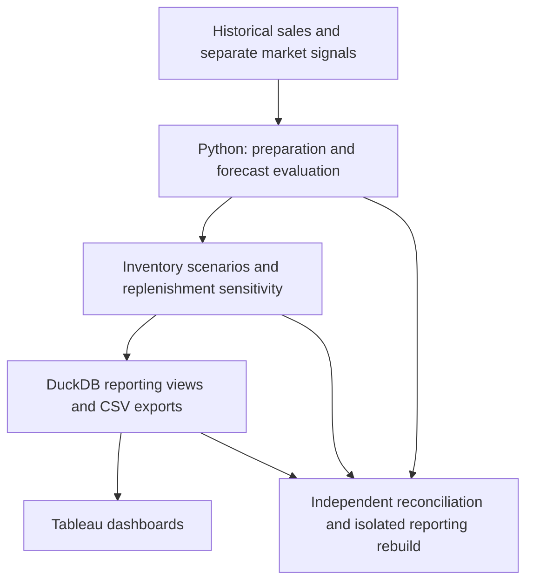
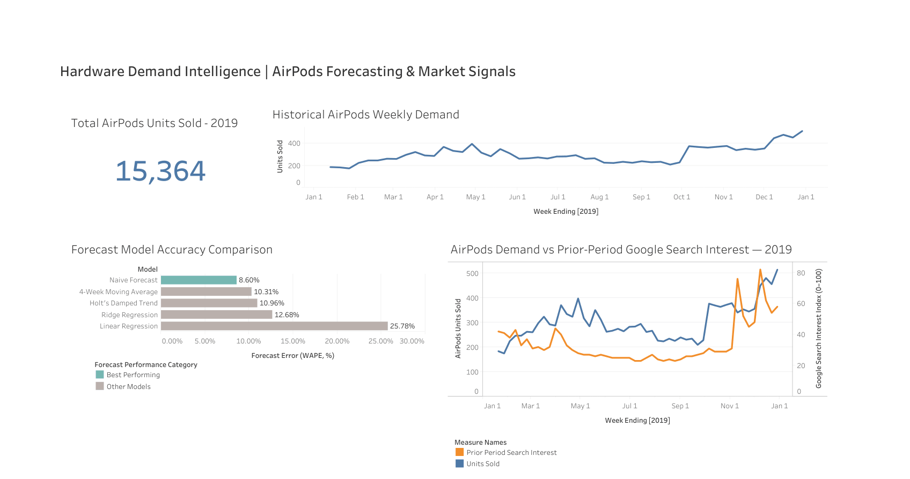
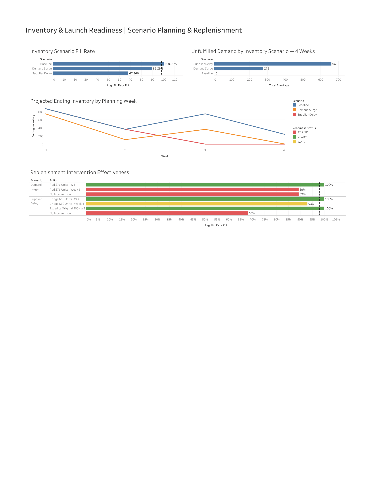
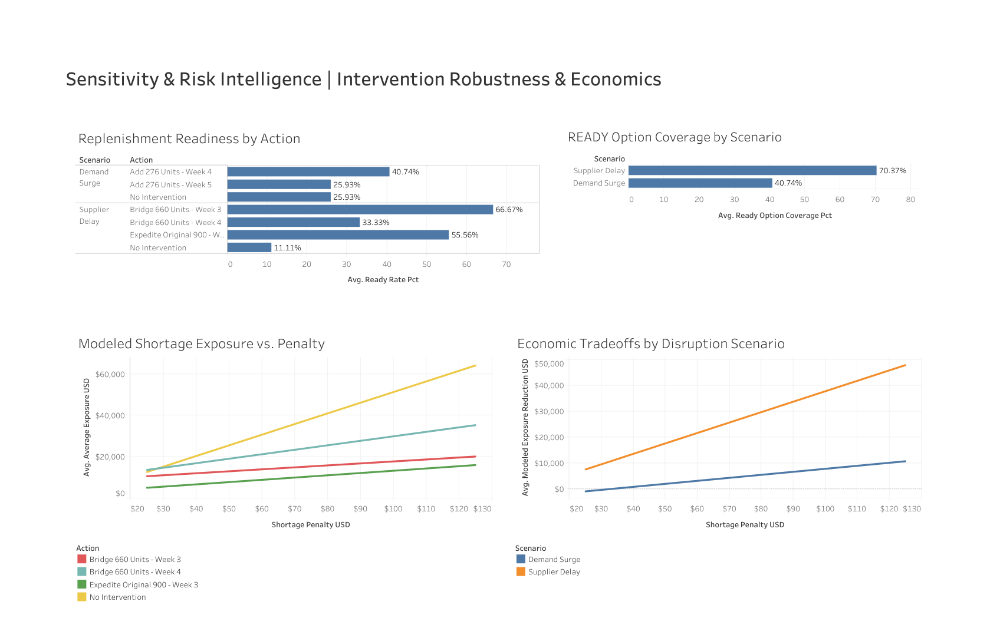
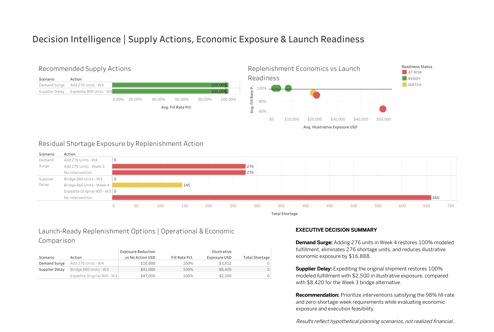

# Hardware Demand-Sensing Planner

**Python · SQL / DuckDB · Forecasting · Inventory Planning · Tableau**

An independent hardware-planning case study that connects historical demand forecasts to simulated inventory risks and replenishment decisions. It answers two questions: **which forecast performs best, and which supply action restores readiness when demand or deliveries change?**

## Key results

| Finding | Result | Evidence |
|---|---:|---|
| Strongest historical forecast | **8.60% WAPE** across 19 rolling evaluations | [Model performance](data/dashboard/dashboard_forecast_model_performance.csv) |
| Demand-surge shortage before intervention | **276 units** | [Inventory scenarios](data/processed/inventory_risk_summary.csv) |
| Supplier-delay shortage before intervention | **660 units** | [Inventory scenarios](data/processed/inventory_risk_summary.csv) |
| Largest modeled exposure reduction | **$47,000**, by expediting the delayed shipment | [Inventory and intervention analysis](08_inventory_launch_scenarios.ipynb) |
| Intervention coverage | **567 evaluations across 162 operating cases** | [Sensitivity analysis](09_inventory_sensitivity_analysis.ipynb) |

**Decision:** retain the simple naive forecast as the historical benchmark; prioritize replenishment timing and test whether proposed actions still work when assumptions change. The $47,000 is a reduction in illustrative shortage exposure, not realized savings.

[Methodology and validation](docs/methodology.md) · [Technical audit](13_final_project_validation.ipynb) · [Tableau workbook](tableau/Hardware_Demand_Intelligence.twb)

## Business problem and approach

A forecast error does not directly identify a purchasing action. Planners must translate uncertainty into inventory availability, shortage timing, service levels, and feasible interventions.

The analysis compares five forecasting methods on 51 complete weeks of historical AirPods sales totaling 15,364 units. Separate modules analyze eCommerce activity, electronics retail patterns, purchase intent, and Google Trends. These sources describe different populations and are not joined as if they shared customers or transactions.

Four-week inventory simulations compare baseline, demand-surge, and supplier-delay conditions. Replenishment alternatives are then evaluated against a **98% fill-rate threshold and zero shortage weeks**, with sensitivity testing across demand, inventory, timing, and economic assumptions.

## Dashboards

### Demand intelligence

The naive model outperformed the more complex alternatives in the original rolling evaluation. Google Trends improved a separate Ridge comparison from 10.88% to 9.92% WAPE; that experiment uses a different evaluation configuration.

[Open dashboard PDF](tableau/exports/01_demand_intelligence.pdf)

### Inventory and launch readiness

Without intervention, modeled fill rates fall to 89.29% under demand surge and 67.96% under supplier delay. Targeted replenishment restores 100% in the evaluated reference cases.

[Open dashboard PDF](tableau/exports/02_inventory_launch_readiness.pdf)

### Sensitivity and risk

At least one READY action exists in 40.74% of demand-surge cases and 70.37% of supplier-delay cases. A reference-case success does not guarantee robust coverage.

[Open dashboard PDF](tableau/exports/03_sensitivity_risk.pdf)

### Decision intelligence

Expediting the original delayed shipment reduces illustrative exposure from $49,500 to $2,500 in its reference case. Supplier feasibility and full intervention costs would need confirmation before acting.

[Open dashboard PDF](tableau/exports/04_decision_intelligence.pdf)

## Technical evidence and navigation

| Location | Purpose |
|---|---|
| Root notebooks `00`–`06` | Environment, source exploration, forecasting, and data integration |
| [Forecast validation](07_forecasting_validation.ipynb) | Multi-horizon evaluation and uncertainty |
| [Inventory scenarios](08_inventory_launch_scenarios.ipynb) and [sensitivity](09_inventory_sensitivity_analysis.ipynb) | Readiness, intervention economics, and robustness |
| [Warehouse rebuild](10_reproducible_data_pipeline.ipynb) and [external signals](11_external_demand_signals.ipynb) | Reporting reconstruction and Google Trends experiments |
| [Dashboard preparation](12_executive_dashboard_preparation.ipynb) and [technical audit](13_final_project_validation.ipynb) | Reporting exports and independent checks |
| [Processed data](data/processed/), [dashboard exports](data/dashboard/), and [validation reports](reports/validation/) | Saved evidence for the reported findings |
| [Methodology](docs/methodology.md) | Detailed assumptions, results, validation, and reproduction boundaries |

The saved technical audit documents independent KPI reconciliation and an isolated rebuild matching **18 of 18 reporting views**. This is evidence about the prepared reporting layer; it does not establish a complete rebuild from raw downloads.

## Reproduction and limitations

The notebooks use pandas, NumPy, DuckDB, scikit-learn, statsmodels, and Jupyter. There is no dependency lockfile or one-command raw-data rebuild. Inspect the input paths before execution: Notebook 01 contains author-specific source paths, raw datasets and DuckDB warehouses are excluded from Git, and later notebooks require prepared inputs or an existing source warehouse.

With those prerequisites supplied, execute the numbered notebooks from the repository root in order. The [detailed reproduction guide](docs/methodology.md#103-technology-requirements) describes the environment and the boundaries of the reporting rebuild. Tableau connections may need relinking to the local CSVs.

Historical sales are a teaching-data benchmark, not verified Apple operations. Supply quantities, lead times, penalties, and interventions are hypothetical. The short forecast history limits generalization; external signals do not establish causation or consistently superior forecasts.

The most useful extensions are portable source paths, a recorded dependency environment, a complete raw-data rebuild, and testing with longer histories and actual inventory records.
